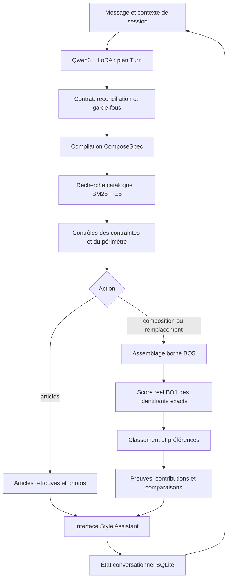

# DressMe — Bilan technique de BO5 et de son intégration à BO1

**Date de référence : 3 novembre 2026.**

**Instantané avant correction conversationnelle v2.** Les trois défauts décrits dans ce bilan ont ensuite été corrigés au niveau des mécanismes et retestés. L'état actuel et les preuves sont dans [CONVERSATION_FIXES.md](C:/Users/GIGABYTE/Desktop/DressMe/diagnostics/CONVERSATION_FIXES.md). Le PDF déjà fourni conserve l'état de cet audit antérieur.

**Périmètre :** état réellement présent dans l'application locale, comparaison avec le notebook BO5, mécanismes d'inférence, preuves disponibles et limites de validation. Ce document ne déclare pas les trois défauts du parcours utilisateur corrigés.

**Méthode de rédaction :** inspection du code, du notebook sans exécution de ses cellules, des exports, des reçus d'entraînement et des rapports enregistrés. Les dimensions des données, les empreintes des poids et le contenu du cache RAG ont été revérifiés lors de cette rédaction. Les 60 tests et les 50 demandes cités sont les exécutions antérieurement enregistrées ; ils n'ont pas été relancés pour produire ce document. Le parcours utilisateur de cinq messages a été reproduit le 3 novembre dans une session HTTP distincte.

## 1. Positionnement et conclusion technique

BO5 est la couche d'interprétation, d'orchestration, de recherche, de contrôle et d'explication de DressMe. Son rôle est de transformer une demande en langage naturel en opérations sur les vêtements réellement disponibles, puis de présenter des résultats et des calculs traçables.

BO1 apporte actuellement un **scoreur de compatibilité entraîné**, consommé par BO5. Les propositions du chat sont construites par un **assemblage borné dans BO5**, puis notées par ce scoreur. Le générateur entraîné RQ-VAE/MiniGPT du notebook BO1 ne dispose pas de l'export nécessaire à son intégration.

**Conclusion au 3 novembre : prototype local intégré et instrumenté, avec scoring BO1 reproductible depuis les embeddings exportés ; validation fonctionnelle partielle du chat. La pertinence générale et la continuité des conversations à plusieurs propositions ne sont pas acquises.**

| Élément | État démontré | Réserve principale |
| --- | --- | --- |
| Application et interface | FastAPI, endpoints BO5/BO1 et chat intégrés au template existant | Usage local, comptes utilisateurs non intégrés |
| Catalogue | 653 identifiants et 653 images locales | Genres, prix et palettes complètes absents |
| Parseur | Qwen3-1.7B + adaptateur existant, inférence locale NF4 | Erreurs sémantiques persistantes dans certains contextes |
| Réconciliation | Corrections lexicales FR/EN et traces avant/après | Couverture limitée ; intervient après certains rejets de citations |
| Recherche | BM25 + E5 multilingue effectivement indexés | Pertinence illustrée, sans benchmark humain annoté |
| Score BO1 | Poids réels chargés, références du notebook reproduites | Score appris de compatibilité, sans garantie esthétique humaine |
| Proposition | Assemblage BO5 borné et filtré | Absence de générateur MiniGPT exporté et de garantie d'optimalité |
| Préférences / comparaisons | Calculs et contributions consultables | Un pool sans article pertinent rend une préférence inopérante |
| Remplacement | Conservation des pièces de la tenue ciblée dans des cas testés | La liste des autres propositions peut être écrasée |
| Photos personnelles | Stockage et correction des métadonnées | Encodage et scoring BO1 bloqués par défaut de parité |

## 2. Architecture générale de l'application

Le backend est une application **FastAPI**, lancée avec **Uvicorn**. Uvicorn est le serveur ASGI ; FastAPI est le framework applicatif. L'interface utilise HTML, CSS et JavaScript et est servie par le même backend. Le chat ne nécessite pas de compilation React ou de serveur Node.

Le fichier `api.py` conserve les fonctions historiques de l'application et enregistre les nouveaux routeurs. Les écrans historiques utilisent leur catalogue de 159 produits ; Style Assistant utilise les 653 produits de l'export BO1. Les correspondances entre catalogues passent par les identifiants produits, pas par une égalité supposée entre indices.



Ce diagramme représente le parcours principal. Une explication relit les résultats et calculs conservés. Une question générale reçoit actuellement une réponse déterministe sur les capacités. Une comparaison de préférences peut réutiliser les candidats précédents au lieu de relancer leur construction.

Sources : [enregistrement des routeurs](C:/Users/GIGABYTE/Desktop/DressMe/api.py:134), [orchestrateur](C:/Users/GIGABYTE/Desktop/DressMe/dressme/engine.py:202), [interface du chat](C:/Users/GIGABYTE/Desktop/DressMe/static/assistant.js).

## 3. Agents : conception du notebook et implémentation effective

### 3.1 Graphe présent dans le notebook BO5

Le notebook `bo5-integ (1).ipynb`, cellule 32, définit `FashionCompositionAgent` et construit un graphe **LangGraph** avec quatre nœuds :

```text
START → understand → compile → execute → explain → END
```

Des transitions conditionnelles permettent de passer directement à l'explication lorsqu'une erreur ou une clarification est déjà déterminée.

Le notebook contient également :

- `HFParser` pour l'adaptateur local ;
- `RoutedClient` pour le routage des appels structurés ;
- `PlanAudit` pour un audit LLM du plan ;
- `ProductRAG` pour la recherche ;
- `BO1Consumer` pour la consommation du moteur BO1 ;
- des contrats BO1 par module, HTTP ou registre ;
- une revue contextuelle fondée sur des références de preuves ;
- un chemin de réponse générale par LLM.

Le client Ollama du notebook prévoit par défaut `qwen3:4b` via une configuration modifiable. Sa présence dans le notebook ne prouve pas son exécution dans l'application locale.

### 3.2 Ce qui fonctionne dans l'application actuelle

La classe `dressme.engine.Assistant` orchestre directement les étapes Python. Elle ne construit pas le graphe LangGraph du notebook. Le chemin actuel ne fait appel ni au reviewer Ollama, ni à `PlanAudit`, ni à un rédacteur LLM séparé.

On peut présenter des **rôles fonctionnels d'agents**, à condition de préciser leur implémentation :

| Rôle fonctionnel | Implémentation locale | Nature du traitement |
| --- | --- | --- |
| Compréhension / planification | `LocalParser.parse()` | Un appel Qwen3-1.7B + LoRA |
| Réconciliation du plan | `normalize_contract()` et `reconcile_turn()` | Règles explicites fondées sur les mots du message |
| Validation et compilation | `validate_turn()` et `compile_spec()` | Schémas, vérifications, fusion des facettes |
| Recherche | `ProductRAG.score()` | BM25 et embeddings E5 |
| Composition | `Assistant._assemble()` | Construction combinatoire bornée |
| Évaluation BO1 | `BO1Backend.score()` | Inférence du Transformer entraîné |
| Personnalisation | `Assistant.rank()` | Formule pondérée et correspondance des préférences |
| Vérification | `constraint_reports()` et contrôles d'identifiants | Vérifications déterministes sur les données connues |
| Explication | `Assistant.handle()`, `_public()` et interface | Calculs et textes déterministes |
| Mémoire | `Sessions` | SQLite et verrouillage par session |

La formulation techniquement exacte est : **« architecture à rôles spécialisés, orchestrée dans un backend Python, avec un LLM pour l'interprétation »**. Présenter la version locale comme plusieurs LLM autonomes qui discutent, se contrôlent mutuellement ou prennent des décisions indépendantes dépasserait le code exécuté.

Sources : [notebook BO5](<C:/Users/GIGABYTE/Desktop/DressMe/bo5/bo5-integ (1).ipynb>), [Assistant](C:/Users/GIGABYTE/Desktop/DressMe/dressme/engine.py:21), [réconciliation](C:/Users/GIGABYTE/Desktop/DressMe/dressme/grounding.py:89).

## 4. Intégration de BO1

### 4.1 Artefacts consommés

Le chemin `DRESSME_BO1_DIR` vaut par défaut `bo1/score`. Le backend charge :

| Fichier | Rôle |
| --- | --- |
| `dressme_core.py` | Architecture `OutfitScorer` issue de l'export |
| `config.json` | Dimensions, nombre de couches, nombre maximal d'articles et état de fine-tuning |
| `scorer.pt` | Poids entraînés du scoreur |
| `emb_ft.npy` | Vecteurs des articles utilisés pour le scoring |
| `emb_clip.npy` | Matrice CLIP de comparaison |
| `catalog.json` | Identifiants, descriptions et catégories, dans l'ordre de l'export |
| `outfits.json` | Signatures des tenues sources |
| `img/` | Images locales affichées dans le chat |
| `visual.pt` | Poids visuels disponibles pour le diagnostic photo ; non nécessaires au scoring depuis les vecteurs déjà exportés |

`BO1Backend` importe l'architecture exportée, instancie le scoreur avec une partie visuelle `Identity` pour ce chemin d'inférence, puis charge `scorer.pt` avec `strict=True` et `weights_only=True`. Le modèle est mis en `eval()` et exécuté sous `torch.inference_mode()`.

Les matrices sont vérifiées : dimensions `(653, 512)` et valeurs finies. Les identifiants sont uniques et la table `Catalog.pos` donne la ligne d'embedding correspondant à chaque identifiant. La même combinaison d'identifiants est renvoyée avec son score et comparée à la combinaison soumise.

### 4.2 Architecture et signification du score

L'architecture exportée comprend une projection `512 → 256`, un token appris de type CLS, deux couches Transformer à quatre têtes d'attention et une tête de score :

```text
score_BO1 = 10 × sigmoid(tête_score(représentation_CLS))
```

Le masque indique les articles présents dans les lots de longueurs variables. Le backend accepte de un à cinq identifiants distincts et calcule les scores par lots de 128 au maximum. Le chemin local du scoreur utilise le CPU.

Une autre tête évalue les articles atypiques, avec une classe supplémentaire « aucun intrus ». Le champ `odd_position` transmet l'argmax de cette tête ; ce n'est pas une explication causale du score.

`config.json` indique `finetuned: false` et les matrices `emb_ft.npy` et `emb_clip.npy` sont identiques. Le Transformer de compatibilité a bien des poids entraînés ; les exports ne démontrent pas qu'un fine-tuning final supplémentaire de CLIP a été conservé.

Le score mesure une compatibilité apprise à partir des tenues sources et de corruptions artificielles. Il ne constitue ni une note esthétique humaine, ni une probabilité de satisfaction, ni une preuve de confort ou d'adaptation à la météo.

Sources : [backend BO1](C:/Users/GIGABYTE/Desktop/DressMe/dressme/bo1.py:17), [architecture exportée](C:/Users/GIGABYTE/Desktop/DressMe/bo1/score/dressme_core.py:84), [configuration](C:/Users/GIGABYTE/Desktop/DressMe/bo1/score/config.json).

### 4.3 Liaison BO5 / BO1 et contrat

Dans l'application, BO5 appelle directement `self.bo1.score(...)` en Python, dans le même processus. Des endpoints HTTP exposent aussi le contrat ; ils ne signifient pas qu'un microservice BO1 séparé est utilisé en interne.

Exemple de requête :

```json
{"outfits": [["P01130437", "P01132492", "P01118538"]]}
```

La réponse associe `item_ids`, `value`, l'échelle `[0,10]`, `model_id`, `embedding_source` et `odd_position`.

Les capacités annoncées sont :

```json
{
  "can_score": true,
  "can_propose": false,
  "can_complete": false,
  "can_encode_photo": false
}
```

Les routes de proposition, complétion et encodage photo renvoient HTTP 503 tant que ces capacités sont absentes. Il n'y a pas de MiniGPT aléatoire présenté comme un générateur entraîné.

Sources : [contrat de score HTTP](C:/Users/GIGABYTE/Desktop/DressMe/dressme/routes.py:217), [capacités BO1](C:/Users/GIGABYTE/Desktop/DressMe/dressme/bo1.py:38).

### 4.4 Preuves de reproduction

| Référence du notebook | Score rechargé depuis les embeddings | Référence arrondie |
| --- | --- | --- |
| Trois premiers identifiants du tirage `random.Random(0)` | 3,4180865 | 3,42 |
| Quatre premiers identifiants du même tirage | 3,3186622 | 3,32 |

Ces valeurs établissent la reproduction de ces références de scoring. Elles ne valident pas la qualité esthétique de nouvelles recommandations.

L'identité du scoreur est `BO1/OutfitScorer:39efbe093325f1ea`. L'empreinte complète vérifiée de `scorer.pt` est `39efbe093325f1ea5d775ca276fa431540b4d4d535be63c3b0b40afd5c532643`.

Preuve : [rapport de vérification](C:/Users/GIGABYTE/Desktop/DressMe/diagnostics/verification.json).

### 4.5 Génération entraînée et photos : capacités restantes

Le notebook de complétion décrit RQ-VAE et MiniGPT avec un catalogue de 643 articles. Il manque leurs poids entraînés et les tables d'inférence. Les noms d'export proposés sont `rq.pt`, `gpt.pt`, `tables.npz` et `completion_config.json`. Ces noms ne désignent pas des fichiers déjà disponibles.

Le script `export_completion_from_kernel.py` doit être exécuté dans le kernel d'origine contenant encore les objets entraînés. Il exporte aussi les codes, correspondances produit/tokens, normalisation, embeddings, probabilités de couleur, PMI, vocabulaires, paramètres de génération et informations de split. L'adaptation de l'inférence et le rapprochement des 643/653 articles par identifiant restent ensuite à réaliser. Le notebook signale une séparation train/test imparfaite à conserver dans l'interprétation de ses métriques.

Le chemin photo a, lui, été exécuté : cosinus de **0,9187 à 0,9620**, sous le seuil de 0,97 du test du notebook. Un score photo de **3,2798264** est obtenu contre **3,3186622** depuis les embeddings exportés. Les images disponibles sont des JPEG de 320 px, alors que le chemin d'origine utilisait des images de 448 px avec une autre qualité JPEG ; les poids visuels sont stockés en FP16. Ces différences sont des pistes de diagnostic, sans attribution causale démontrée à l'une d'elles.

Sources : [script d'export](C:/Users/GIGABYTE/Desktop/DressMe/scripts/export_completion_from_kernel.py:10), [diagnostic photo](C:/Users/GIGABYTE/Desktop/DressMe/scripts/verify_local.py:16), [résultats](C:/Users/GIGABYTE/Desktop/DressMe/diagnostics/verification.json).

## 5. Parseur BO5 : apprentissage, chargement et plan

### 5.1 Modèle et traçabilité

| Paramètre | Valeur issue du reçu |
| --- | --- |
| Base | `Qwen/Qwen3-1.7B` |
| Révision | `70d244cc86ccca08cf5af4e1e306ecf908b1ad5e` |
| Méthode | QLoRA, apprentissage sur les réponses structurées |
| Quantification | NF4 avec double quantification ; calcul FP16 |
| LoRA | Rang 16, alpha 32, dropout 0,05 |
| Optimisation | AdamW, taux d'apprentissage 0,0001 |
| Batch / accumulation | 1 / 8 |
| Longueur d'entraînement | 2 048 tokens |
| Données exportées | 2 400 train, 240 validation, 240 test |
| Fin du run | 550 étapes, arrêt anticipé |
| Checkpoint retenu | 400, sélectionné sur la perte de validation |
| Meilleure perte de validation enregistrée | 0,00650666 |

Ces informations décrivent l'entraînement antérieur enregistré. Aucun entraînement n'a été relancé pendant l'intégration locale. La faible perte de validation n'est pas une mesure suffisante de pertinence des recommandations ou de compréhension sur des conversations libres.

Les 2 880 lignes des trois splits portent toutes l'origine `synthetic_plan_first`. Le parseur a donc été évalué ici sur des données synthétiques issues de plans, et non sur un corpus démontré de conversations réelles annotées par des utilisateurs. La généralisation aux formulations et enchaînements libres doit être évaluée séparément.

L'adaptateur est chargé depuis `bo5/parser_for_local/parser_adapter/`. Son SHA-256 est vérifié : `312555f49aa114b85bb4994d79ea941f31e81a8a23448313b7602ea9e784c003`. Le vocabulaire et l'EOS du tokenizer sont comparés à ceux de la base épinglée. Le modèle est chargé une fois, en mode évaluation.

L'inférence locale utilise `do_sample=False`, `enable_thinking=False` et au maximum 1 200 nouveaux tokens. Le chargeur évite la troncature silencieuse et vérifie le budget de contexte. NF4 exige CUDA ; une panne de chargement n'entraîne pas un basculement automatique vers un autre modèle.

Sources : [reçu](C:/Users/GIGABYTE/Desktop/DressMe/bo5/parser_for_local/parser_adapter/training_receipt.json), [chargeur](C:/Users/GIGABYTE/Desktop/DressMe/dressme/parser.py:46).

### 5.2 Contrat de sortie

Le modèle produit un objet `Turn` validé par Pydantic. Les actions sont `compose`, `products`, `replace`, `compare`, `explain`, `preferences`, `general` et `clarify`.

Chaque `Facet` décrit un champ, des valeurs canoniques anglaises, un mode logique, une force et une citation du message. Elle peut aussi préciser les rôles concernés.

| Élément | Signification |
| --- | --- |
| `must` | Condition obligatoire |
| `prefer` | Préférence facultative utilisée pour le classement |
| `any` | Présence d'au moins une valeur / alternatives |
| `all` | Présence de chaque valeur demandée |
| `only` | Restriction de tous les articles concernés aux valeurs autorisées |
| `exclude` | Interdiction |
| `clear` | Retrait d'une facette précédente |
| `reuse_previous` | Dépendance au contexte précédent |
| `selection_number` | Numéro de proposition visée, entre 1 et 5 |
| `target_role` | Rôle de la pièce remplacée |
| `before_facets` | Premier scénario explicitement fourni pour une comparaison |

La compilation transforme ensuite `Turn` en `ComposeSpec` : facettes actives, requête de recherche, périmètre catalogue/dressing, nombre de propositions et budget éventuel.

Sources : [schémas](C:/Users/GIGABYTE/Desktop/DressMe/dressme/schemas.py:25), [compilation](C:/Users/GIGABYTE/Desktop/DressMe/dressme/constraints.py:29).

### 5.3 Réconciliation et contrôles

`grounding.py` intervient après la génération et une première validation du contrat. Un lexique FR/EN permet de rétablir certains types explicites omis, de corriger une mauvaise traduction connue et d'identifier les rôles structuraux. Les règles traitent également les préférences facultatives, les recherches indépendantes, les scénarios hypothétiques, les réponses de devise en attente et certains champs structurels mal placés.

La réconciliation ne modifie ni les poids, ni les descriptions produit, ni les scores. Elle conserve le plan du modèle et enregistre chaque correction avec règle, citation, valeur initiale et valeur finale.

Les contrôles vérifient notamment les citations, certaines négations, les valeurs de couleur, les quantités, la présence du genre explicite et de types de vêtements reconnus. Ils ne constituent pas un oracle sémantique complet.

**Limite démontrée :** une citation inventée peut être rejetée avant que la réconciliation ne traite le reste du plan. Dans le parcours utilisateur, le mot `shoes` est cité dans une demande française qui ne le contient pas. Le contrôle bloque le plan, mais le chat ne parvient alors pas à exécuter une demande pourtant claire.

Le payload fournit actuellement une liste fixe de genres et de huit couleurs comme vocabulaire. Ces listes ne représentent pas les attributs vérifiés des articles. Leur copie indue dans des facettes a été observée. La méthode `ProductRAG.hints()` existe, mais ses indices taxonomiques ne sont pas transmis par le chemin local `Assistant → LocalParser`.

Sources : [génération et ordre des contrôles](C:/Users/GIGABYTE/Desktop/DressMe/dressme/parser.py:142), [validation](C:/Users/GIGABYTE/Desktop/DressMe/dressme/parser.py:195), [réconciliation](C:/Users/GIGABYTE/Desktop/DressMe/dressme/grounding.py:89).

## 6. Catalogue commun et qualité des données

Le manifeste expose identifiant stable, description, catégorie, rôle structurel, image, couleurs décrites, genre, prix, devise, provenance et appartenance éventuelle au dressing.

L'inspection actuelle donne :

| Catégorie brute | Articles |
| --- | ---: |
| Hauts | 171 |
| Bas | 138 |
| Chaussures | 106 |
| Vêtements extérieurs | 104 |
| Sacs | 56 |
| Autres / rôle inconnu | 32 |
| Accessoires | 25 |
| Robes | 21 |
| **Total** | **653** |

Les 653 images sont présentes. Aucun genre produit ni prix n'est renseigné dans l'état de base inspecté. Aucune palette de couleur n'est déclarée complète.

Les couleurs connues sont extraites littéralement des descriptions. Cela ne constitue pas une détection visuelle complète : une pièce décrite comme noire peut avoir des motifs blancs. Des palettes de tenues ne sont pas attribuées arbitrairement aux produits. Des rôles ou catégories issus des descriptions peuvent aussi être imparfaits.

Les corrections dans le dressing restent privées à la session. Un fichier optionnel `data/product_metadata.json` peut compléter les genres, prix et devises avec provenance. Les données de démonstration ne deviennent pas automatiquement des vêtements possédés.

Source : [construction du catalogue](C:/Users/GIGABYTE/Desktop/DressMe/dressme/catalog.py:17).

## 7. RAG : recherche documentaire hybride

### 7.1 Corpus et rôle de la recherche

Chaque produit constitue un document à partir de son nom, sa description, sa catégorie, son rôle et de ses attributs connus. La recherche alimente les candidats, les classements et les preuves affichées.

Le terme RAG désigne ici cette recherche documentaire intégrée au pipeline de recommandation. Dans la version locale, les passages ne sont pas injectés dans un rédacteur LLM chargé de générer la réponse finale : les textes finaux sont produits par des gabarits et les données réellement sélectionnées.

### 7.2 Partie lexicale BM25

Le texte est normalisé et tokenisé en mots. Le score lexical utilise les fréquences des termes, leur rareté dans le corpus et la longueur des documents, avec les constantes équivalentes à `k1=1,5` et `b=0,75`.

Le score est normalisé par le maximum observé sur le corpus pour la requête. Une absence de correspondance lexicale donne zéro, sans empêcher la recherche dense de retrouver un concept traduit.

### 7.3 Partie dense E5

L'encodeur gelé est `intfloat/multilingual-e5-small`, révision `614241f622f53c4eeff9890bdc4f31cfecc418b3`.

- Documents préfixés par `passage:` et requêtes par `query:`.
- Vecteurs normalisés ; comparaison par produit scalaire, équivalente au cosinus.
- Limite de séquence de l'encodeur : 512 tokens.
- Découpage documentaire : 360 tokens avec recouvrement de 48.
- Découpage des requêtes longues : 400 tokens, puis moyenne renormalisée.
- Score dense d'un produit : meilleur score parmi ses passages.
- Encodeur utilisé sur CPU dans le chemin local.

Le cache revérifié contient **653 vecteurs de passage de dimension 384, en float32**. Pour ces descriptions courtes, cela correspond à un passage par article. Les vecteurs produit utilisés pour les préférences sémantiques sont des moyennes de passages renormalisées.

### 7.4 Fusion des signaux

Pour un produit `i` :

```text
L_i = BM25_i / max_j(BM25_j)
D_i = clip((cosinus_E5_i + 1) / 2, 0, 1)
pertinence_i = 0,85 × D_i + 0,15 × L_i
```

Le code protège les divisions par zéro. En mode explicitement lexical, la pertinence est le score lexical normalisé. Une erreur de chargement E5 ne déclenche pas une conversion silencieuse du mode hybride vers le mode lexical.

Le cache documentaire dépend de l'identité de l'encodeur, des identifiants et des passages. Un petit cache en mémoire conserve jusqu'à 128 requêtes encodées. L'implémentation travaille directement avec des matrices NumPy ; aucune base vectorielle externe n'est utilisée dans ce chemin.

### 7.5 Preuve disponible et limites

La requête réelle « une chemise bleue en lin » place `P01138418`, **blue linen shirt**, en tête, avec un cosinus E5 de **0,8485**. Le BM25 vaut zéro sur cet exemple de requête française face à des descriptions anglaises : le signal dense assure la correspondance multilingue.

Ce résultat illustre un fonctionnement pertinent sur un cas. Il ne constitue pas un Recall@k, un nDCG ou une précision mesurés sur des jugements humains. Aucun jeu de jugements de pertinence n'est présenté comme disponible pour cette évaluation locale.

Les corrections privées de métadonnées ne reconstruisent pas automatiquement le corpus E5 de base ; les contraintes utilisent les produits corrigés, tandis que la recherche demeure fondée sur l'index du catalogue. C'est une limite d'alignement à considérer.

Sources : [recherche complète](C:/Users/GIGABYTE/Desktop/DressMe/dressme/rag.py:32), [fusion](C:/Users/GIGABYTE/Desktop/DressMe/dressme/rag.py:143), [rapport RAG](C:/Users/GIGABYTE/Desktop/DressMe/diagnostics/verification.json).

## 8. Contrôles des contraintes et assemblage BO5

Les contraintes obligatoires servent à vérifier l'admissibilité ; les préférences servent au classement. Une préférence n'est pas transformée automatiquement en filtre dur.

La vérification utilise les métadonnées réellement connues. Un budget exige des prix et une devise cohérente. Un genre inconnu ne passe pas un filtre de genre strict. Une exclusion ou une restriction exclusive de couleur exige une palette complète. Les propriétés de style, occasion, saison et objectif restent des signaux de pertinence avec statut non vérifié, faute d'annotations produit suffisantes.

Le budget est interprété avec `Decimal` pour le montant et avec Babel pour les devises. Le symbole `$` seul ne suffit pas à identifier une devise. Les suivis explicites peuvent compléter une devise en attente.

Pour la composition, `_assemble()` :

1. choisit le catalogue ou le dressing explicitement demandé ;
2. conserve les produits scorables, avec rôle connu et image présente ;
3. applique les contrôles d'admissibilité ;
4. retient par défaut les huit produits les plus pertinents par rôle ;
5. ajoute des représentants de certains critères positifs obligatoires, s'ils sont en dehors des premiers résultats ;
6. construit les combinaisons `haut + bas + chaussures` ou `pièce unique + chaussures`, avec rôles supplémentaires explicitement nécessaires ;
7. impose les identifiants fixés par un remplacement ;
8. exclut les combinaisons historiques et les combinaisons non conformes ;
9. examine au plus 20 000 signatures et conserve au plus 512 candidats pour le scoring ;
10. appelle le vrai BO1 sur les identifiants exacts, puis classe les candidats.

Le nombre par rôle est configurable de 2 à 24 ; des représentants ajoutés peuvent augmenter le pool effectif. Une tenue ne dépasse pas les cinq pièces acceptées par BO1. Un rôle inconnu est écarté de l'assemblage.

L'espace de recherche est borné. Une réponse vide décrit l'absence de candidat conforme parmi ceux examinés, sans preuve d'absence dans le dataset complet. Les poids et limites de recherche sont des choix de prototype, pas des hyperparamètres démontrés optimaux.

La recherche d'articles seule suit une autre branche : filtrage et tri des produits par pertinence, sans score de compatibilité d'une tenue. La réponse actuelle affiche jusqu'à cinq articles, bien que son message indique le nombre total d'articles admissibles.

Sources : [contraintes](C:/Users/GIGABYTE/Desktop/DressMe/dressme/constraints.py:107), [assemblage](C:/Users/GIGABYTE/Desktop/DressMe/dressme/engine.py:69), [branche articles](C:/Users/GIGABYTE/Desktop/DressMe/dressme/engine.py:281).

## 9. Personnalisation et classement

Pour une tenue `T`, le classement utilise :

```text
S(T) = 0,65 × (score_BO1(T) / 10)
     + 0,25 × moyenne_pertinence_des_articles(T)
     + 0,10 × score_préférences(T)
```

Les poids sont configurables et leur somme est contrôlée. Les deux premiers termes mesurent des signaux différents : compatibilité entre vêtements et correspondance à la demande.

Pour une préférence positive de couleur ou de type, le score actuel est généralement binaire : une pièce correspondante suffit à produire une valeur de 1. Plusieurs préférences sont moyennées. Une préférence d'exclusion utilise les valeurs connues des pièces évaluées ; elle ne garantit pas une absence de couleur secondaire inconnue et ne remplace jamais un filtre strict.

Les préférences de style, occasion ou saison peuvent utiliser une affinité E5 entre leur texte et les descriptions. Ce calcul est explicitement identifié comme une affinité documentaire, sans preuve que la propriété soit vraie pour le produit. En mode lexical, cette affinité dense est indisponible.

Le score sans préférences est recalculé sur le même ensemble :

```text
S_sans_préférences(T) = [0,65 × BO1_normalisé(T) + 0,25 × pertinence(T)] / 0,90
```

Les rangs avec et sans préférences sont enregistrés. C'est une ablation du terme de préférence sur un ensemble fixé. Cette comparaison n'est pas une démonstration causale de satisfaction ou d'utilité pour l'utilisateur.

Une préférence ne peut modifier le choix que si le pool contient des candidats auxquels elle peut s'appliquer. L'absence de couverture du pool est précisément le problème observé pour le bleu dans le parcours utilisateur.

Source : [classement et contributions](C:/Users/GIGABYTE/Desktop/DressMe/dressme/engine.py:147).

## 10. Explicabilité et limites des explications

Les explications locales reposent sur quatre types de preuves :

| Preuve | Contenu affichable | Limite |
| --- | --- | --- |
| Produit | Identifiant, photo, description, provenance | Dépend de la qualité des annotations |
| Contrainte | Facette, articles évalués, résultat, motif d'inconnu | Certaines propriétés sémantiques restent non vérifiées |
| Score | BO1, pertinence, préférences, poids et contributions | Le détail des contributions concerne le classement final |
| Comparaison | Avant/après, identifiants conservés et delta calculé | Ne garantit pas une amélioration |

Pour comparer deux tenues, le code calcule les différences de score BO1, de score total et de contributions. Pour un remplacement, il recalcule les scores sur les identifiants avant/après.

Il n'y a actuellement ni SHAP, ni LIME, ni attribution interne démontrée au Transformer. Affirmer que BO1 a choisi une tenue « grâce à la texture » ou qu'elle protège de la pluie ne serait pas justifié par les calculs disponibles.

La rédaction du chat est déterministe. Cela évite l'invention libre de détails produit par un rédacteur, mais les phrases restent génériques. Une réponse arithmétiquement exacte peut ainsi être peu informative lorsque la préférence n'a aucun effet ou lorsque les candidats sont peu variés.

Sources : [sortie publique et explication](C:/Users/GIGABYTE/Desktop/DressMe/dressme/engine.py:189), [affichage des preuves](C:/Users/GIGABYTE/Desktop/DressMe/static/assistant.js:30).

## 11. Mémoire, dressing et contrat API

Le navigateur reçoit un identifiant aléatoire de session via un cookie HttpOnly et SameSite Strict. L'attribut Secure est utilisé en HTTPS. Le serveur stocke un document JSON par session dans SQLite et applique un verrou par session pour les opérations liées au chat.

L'état comprend les préférences, les identifiants du dressing, les corrections de métadonnées, les photos personnelles, la conversation active et l'historique. L'historique conserve les 40 derniers messages, soit au plus 20 couples demande/réponse. Il stocke les textes ; il ne constitue pas un journal complet horodaté de tous les plans et réponses détaillées.

La route nommée `/profile` représente cet état local. Le futur module de comptes/profil utilisateur, notamment le genre par défaut, reste le travail du membre d'équipe annoncé. Il n'est pas présenté ici comme intégré.

| Route | Fonction |
| --- | --- |
| `GET /api/assistant/health` | Capacités et identité des modèles |
| `POST /api/assistant/chat` | Message de 1 à 2 500 caractères, champs supplémentaires refusés |
| `GET /api/assistant/catalog` | Catalogue commun et corrections de session |
| `GET /api/assistant/profile` | État local, historique et sélection courante |
| `POST /api/assistant/reset` | Réinitialisation de la conversation |
| `PUT /api/assistant/preferences` | Préférences facultatives |
| `PUT /api/assistant/wardrobe` | Déclaration des articles possédés |
| `PATCH /api/assistant/wardrobe/{id}` | Métadonnées privées corrigées |
| `POST /api/assistant/wardrobe/photo` | Import photo, 8 Mio et 24 mégapixels au maximum |
| `GET /api/assistant/images/{id}` | Photos du catalogue |
| `GET /api/assistant/personal-images/{id}` | Photo privée à la session |
| `GET /api/bo1/health` | Capacités du moteur BO1 |
| `POST /api/bo1/score` | Scores par listes d'identifiants |
| `POST /api/bo1/propose`, `/complete`, `/encode-photo` | Capacité indisponible, HTTP 503 |

Les mutations avec une origine explicitement différente sont refusées. Les images personnelles sont vérifiées contre la session. L'application ne dispose toutefois pas d'une authentification par compte ni d'une gestion de rôles pour un déploiement public.

Sources : [routes](C:/Users/GIGABYTE/Desktop/DressMe/dressme/routes.py:24), [persistance](C:/Users/GIGABYTE/Desktop/DressMe/dressme/state.py:11).

## 12. Environnement, configuration et reproductibilité

L'environnement ayant servi aux vérifications comprend Python 3.11.9, PyTorch 2.8.0 + CUDA 12.6 et une RTX 4060 Laptop de 8 Go. Les versions principales consignées incluent Transformers 4.57.3 et PEFT 0.18.0. Le lock local contient aussi FastAPI, Uvicorn, bitsandbytes, sentence-transformers, Pydantic et leurs dépendances.

Le chargement des modèles est paresseux et partagé dans un processus. Le parseur est protégé par un verrou ; le RAG possède également un verrou. Un seul worker Uvicorn est conseillé sur cette machine pour éviter de dupliquer les modèles en mémoire.

Les révisions et empreintes rendent les artefacts identifiables. Cela ne garantit pas une identité bit à bit entre toutes les cartes GPU, versions de bibliothèques ou précisions numériques.

| Variable | Rôle |
| --- | --- |
| `DRESSME_BO1_DIR` | Export de scoring BO1 |
| `DRESSME_PARSER_ADAPTER` | Adaptateur et tokenizer |
| `DRESSME_CACHE` | Cache des modèles et vecteurs |
| `DRESSME_STATE_DIR` | SQLite et photos personnelles |
| `DRESSME_PARSER_PRECISION` | NF4 par défaut ; autres modes explicitement configurables |
| `DRESSME_PARSER_DEVICE` | Périphérique d'inférence |
| `DRESSME_ALLOW_DOWNLOADS` | Autorisation de récupérer les fichiers manquants |
| `DRESSME_RAG_MODE` | Hybride par défaut, lexical explicite possible |
| `DRESSME_RANKING_WEIGHTS` | Pondération BO1 / recherche / préférences |
| `DRESSME_POOL_PER_ROLE` | Taille de base des pools par rôle |

`hf_syrine` est prioritaire dans le helper d'authentification. Une variable `HF_TOKEN` déjà existante peut être lue en repli, sans création automatique de cette variable. Les valeurs des jetons ne sont pas incluses dans ce rapport ni envoyées à l'interface. Les secrets, caches et états privés sont ignorés par Git.

Les tests du parseur ont été exécutés avec les téléchargements désactivés et les fichiers disponibles localement. Le cache Qwen reste nécessaire : l'adaptateur seul n'est pas un modèle complet. Le lock contient des chemins de roues CUDA propres à la machine ; pour une autre machine, suivre les commandes d'installation du README et installer une distribution PyTorch adaptée.

```powershell
cd C:\Users\GIGABYTE\Desktop\DressMe
.\.venv\Scripts\python.exe -m uvicorn api:app --host 127.0.0.1 --port 8000
```

Sources : [configuration](C:/Users/GIGABYTE/Desktop/DressMe/dressme/config.py), [dépendances](C:/Users/GIGABYTE/Desktop/DressMe/requirements.txt), [lock local](C:/Users/GIGABYTE/Desktop/DressMe/requirements.lock.txt), [installation](C:/Users/GIGABYTE/Desktop/DressMe/README.md).

## 13. Validation : preuves, mesures et portée

### 13.1 Résultats historiques du parseur exporté

`bo5/parser_for_local/reports/test_report.json` contient un rapport sur **80 exemples**, alors que le split test exporté contient 240 lignes. Il ne faut pas assimiler automatiquement ce rapport à une mesure sur tout le split.

| Mesure enregistrée | Valeur |
| --- | ---: |
| Conformité au contrat | 100 % |
| Action correcte | 75 % |
| Réutilisation du contexte correcte | 97,5 % |
| Citations considérées correctes | 97,5 % |
| F1 strict des facettes | 0,9229 |
| F1 structurel | 0,9563 |
| Structure exacte | 71,25 % |

Ces métriques proviennent du rapport livré avec le notebook et concernent ses exemples et sa procédure. Elles n'ont pas été recalculées ici. Elles ne mesurent pas la pertinence esthétique ou la satisfaction des utilisateurs du chat intégré.

### 13.2 Tests locaux enregistrés

**60 tests automatisés** ont passé lors de la dernière série enregistrée. Ils couvrent schémas, contraintes, budget, valeurs inconnues, grounding, références BO1, lots et identifiants, remplacement ciblé, calculs de préférences, isolation des sessions et contrat HTTP.

Une partie des tests d'orchestration fournit des plans contrôlés. Ces tests vérifient la mécanique et utilisent le vrai scoreur, mais ils ne mesurent pas la compréhension du LoRA.

La série API intégrée compte **50 demandes distinctes**, avec **49 comportements conformes aux assertions et un rejet attendu** pour six tenues. Les conversations concernées ont été rejouées après des corrections et les règles finales ont été appliquées aux sorties réelles enregistrées. Les résultats portent sur **LoRA + réconciliation + pipeline**, pas sur le LoRA brut seul.

Les durées consignées dans ce rapport fusionné vont de **5,39 à 24,47 secondes**, avec une médiane d'environ **9,38 secondes**. Les rechargements et conditions des exécutions diffèrent ; ces valeurs sont indicatives et ne constituent pas un benchmark de production ou une mesure de concurrence.

Sources : [tests](C:/Users/GIGABYTE/Desktop/DressMe/tests/test_integration.py), [série API](C:/Users/GIGABYTE/Desktop/DressMe/scripts/verify_chat.py), [rapport API](C:/Users/GIGABYTE/Desktop/DressMe/diagnostics/chat-parser-fixed.json).

### 13.3 Contre-exemple réel du 3 novembre

Le parcours utilisateur suivant a été retrouvé et reproduit exactement :

1. `compose deux tenues`
2. `Explique la première tenue.`
3. `Remplace seulement les chaussures.`
4. `Change les chaussures de la deuxième tenue.`
5. `Et si je préférais le bleu ?`

Trois défauts restent démontrés :

| Défaut | Observation | Explication technique |
| --- | --- | --- |
| Autre proposition perdue | Après remplacement de la première tenue, la deuxième tenue d'origine disparaît | Le code remplace toute la liste affichée par `ranked[:top_n]` à partir des pièces fixées de la seule tenue ciblée |
| Deuxième remplacement refusé | Une citation anglaise `shoes` apparaît dans un message français | Le plan est rejeté avant réconciliation ; d'autres facettes confondent aussi ordinal et quantité |
| Préférence bleue sans effet | Les résultats et rangs restent identiques | Les sept candidats conservés ne comprennent aucun bleu connu ; contribution de préférence `0.0`, sans explication directe dans la réponse |

La préférence sur le même pool est mathématiquement cohérente, mais le pool n'a pas la couverture nécessaire pour explorer le bleu. Le score élevé et l'absence d'erreur de calcul ne suffisent donc pas à établir la pertinence d'une réponse.

Ces observations limitent explicitement la conclusion tirée des 60 tests et des 50 exemples. Le parcours complet et la conservation des propositions non ciblées étaient insuffisamment couverts. Le système ne peut pas être présenté comme entièrement validé au seul motif que ces assertions passent.

Sources : [diagnostic du parcours utilisateur](C:/Users/GIGABYTE/Desktop/DressMe/diagnostics/USER_CHAT_REVIEW.md), [sélection des variantes de remplacement](C:/Users/GIGABYTE/Desktop/DressMe/dressme/engine.py:326).

## 14. Travail restant pour une validation technique complète

| Priorité | Travail à réaliser | Critère vérifiable |
| --- | --- | --- |
| P0 | Modifier uniquement la proposition ciblée lors d'un remplacement | Tous les identifiants des propositions non ciblées restent identiques |
| P0 | Traiter correctement la cible et l'ordinal dans le parcours exact de l'utilisateur | Remplacement de la deuxième tenue exécuté, sans citation inventée ni quantité ajoutée |
| P1 | Détecter l'absence de couverture d'une préférence | Message explicite lorsque sa contribution reste nulle faute de candidats correspondants |
| P1 | Construire, lorsque nécessaire, un pool comparatif couvrant la préférence | Comparaison avant/après sur un pool commun élargi, ou indication claire que les pools diffèrent |
| P1 | Évaluer la diversité utile des propositions | Mesures de recouvrement des pièces et appréciation humaine, au-delà d'identifiants de tenue simplement distincts |
| P1 | Constituer un jeu de demandes et jugements de pertinence | Recall@k / nDCG calculés sur des jugements explicites, sans assimiler les non-jugés à des négatifs |
| P1 | Tester des conversations complètes réservées | Réussite de toute la séquence, pas seulement de requêtes dans des contextes différents |
| P2 | Compléter les données nécessaires aux filtres | Genres, prix, devises et palettes avec provenance contrôlable |
| P2 | Reprendre la parité photo/export | Comparaison sur les images originales et séparation des effets de prétraitement/précision |
| P2 | Exporter et intégrer le générateur BO1 si cet objectif est conservé | Chargement des poids entraînés et contrat de proposition vérifié |
| P2 | Réévaluer les rôles de reviewer/rédacteur du notebook | Périmètre et coût explicités, preuves produit contrôlées, évaluation distincte de celle du parseur |
| Équipe | Relier le futur module utilisateur | Identité, préférences et attributs explicitement fournis reliés à un compte selon le contrat d'équipe |

Ce tableau décrit du travail restant ; la rédaction de ce bilan n'a pas effectué ces corrections.

## 15. Formulation utilisable pour une présentation technique

> Dans DressMe, BO5 transforme une demande en un plan structuré, applique les contraintes et interroge un catalogue local par recherche hybride BM25 et E5 multilingue. J'ai relié cette orchestration au scoreur entraîné de BO1 par une interface qui transmet les identifiants exacts des vêtements et récupère un score de compatibilité reproductible. Le classement combine ce score, la pertinence de recherche et les préférences, avec des contributions consultables. La version locale utilise le LoRA existant pour l'interprétation et une réconciliation traçable pour certaines erreurs. L'intégration est opérationnelle sur les composants disponibles, mais la génération MiniGPT, l'encodage fiable des nouvelles photos et la validation générale de pertinence restent à compléter. Les essais réels ont aussi identifié des défauts précis dans le suivi des remplacements et la couverture des préférences.

## 16. Dossier de preuves et navigation dans le code

| Sujet | Source principale |
| --- | --- |
| Architecture d'origine | [Notebook BO5](<C:/Users/GIGABYTE/Desktop/DressMe/bo5/bo5-integ (1).ipynb>) |
| Orchestration exécutée | [engine.py](C:/Users/GIGABYTE/Desktop/DressMe/dressme/engine.py) |
| Contrats des plans | [schemas.py](C:/Users/GIGABYTE/Desktop/DressMe/dressme/schemas.py) |
| Modèle et contrôles du parseur | [parser.py](C:/Users/GIGABYTE/Desktop/DressMe/dressme/parser.py) |
| Corrections traçables | [grounding.py](C:/Users/GIGABYTE/Desktop/DressMe/dressme/grounding.py) |
| Recherche documentaire | [rag.py](C:/Users/GIGABYTE/Desktop/DressMe/dressme/rag.py) |
| Filtres et budgets | [constraints.py](C:/Users/GIGABYTE/Desktop/DressMe/dressme/constraints.py) |
| Catalogue et provenance | [catalog.py](C:/Users/GIGABYTE/Desktop/DressMe/dressme/catalog.py) |
| Intégration BO1 | [bo1.py](C:/Users/GIGABYTE/Desktop/DressMe/dressme/bo1.py) |
| Routes et sessions | [routes.py](C:/Users/GIGABYTE/Desktop/DressMe/dressme/routes.py), [state.py](C:/Users/GIGABYTE/Desktop/DressMe/dressme/state.py) |
| Modèle entraîné et reçu | [training_receipt.json](C:/Users/GIGABYTE/Desktop/DressMe/bo5/parser_for_local/parser_adapter/training_receipt.json) |
| Vérifications de référence | [verification.json](C:/Users/GIGABYTE/Desktop/DressMe/diagnostics/verification.json) |
| Tests API intégrés | [chat-parser-fixed.json](C:/Users/GIGABYTE/Desktop/DressMe/diagnostics/chat-parser-fixed.json) |
| Limites révélées par l'utilisateur | [USER_CHAT_REVIEW.md](C:/Users/GIGABYTE/Desktop/DressMe/diagnostics/USER_CHAT_REVIEW.md) |
| Empreintes du code inspecté | [bo5-audit-source-manifest.json](C:/Users/GIGABYTE/Desktop/DressMe/diagnostics/bo5-audit-source-manifest.json) |

Les dossiers `bo1/score/`, `bo5/parser_for_local/parser_adapter/` et les modèles de base en cache restent nécessaires à l'exécution locale. Les notebooks ne sont pas exécutés au démarrage du chat ; ils restent les sources de conception et de traçabilité des travaux antérieurs.
